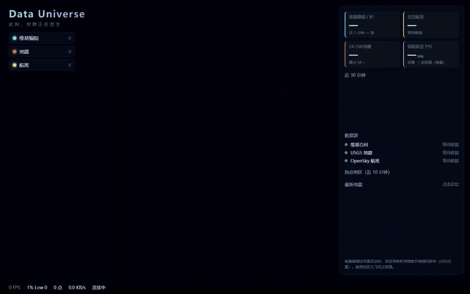

# 🌍 Data Universe

> Watch the world happen — in real time.

实时汇聚 USGS 地震、Wikipedia 编辑和 OpenSky 航班数据流，经 **Redpanda → Flink SQL → ClickHouse** 处理，渲染到 3D 地球上。



自转 → 切换航班图层 → 点击地震飞抵现场（21 秒，10 fps，宽 800px）

> 用 `node web/benchmarks/record-demo.mjs` 生成，需要本机安装 ffmpeg。

**当前进度：W2 可视化**

## 快速开始
```bash
cp .env.example .env      # 修改 HTTP_USER_AGENT 为你的联系方式；填 OpenSky 凭据
make up                   # 启动全链路并提交两个 Flink 作业（W1 事件流 + W2 航班）
make web-build            # 构建前端，由网关托管在 8090
# 等 3 分钟
make verify               # W1 端到端验收
make verify-w2            # W2 验收（21 项）
```

| 服务 | 地址 |
|---|---|
| **前端（网关托管）** | **http://localhost:8090** |
| Redpanda Console | http://localhost:8080 |
| Flink UI | http://localhost:8081 |
| ClickHouse HTTP | http://localhost:8123（du / du_dev） |

验收留档：[verify-w1.txt](docs/assets/verify-w1.txt)（`make verify` 全 PASS）。
逐步执行手册：[W1-runbook](docs/tasks/W1-runbook.md) · [W2-runbook](docs/tasks/W2-runbook.md)。

### 性能
`make bench` 在 2 万维基点 + 1 万航班下实测：**60 FPS / 1% Low 59.5**，GPU 为 Intel D3D11 硬件加速。
结果见 [benchmarks/results/](benchmarks/results/)。

### Windows 环境注意
`make` 的 recipe 在原生 Windows 下会因路径转换与引号处理出错，建议改用 Git Bash 执行等价命令：

```bash
export MSYS_NO_PATHCONV=1
export PATH="/c/Program Files/Docker/Docker/resources/bin:$PATH"
bash scripts/verify.sh                                   # 代替 make verify
gateway/.venv/Scripts/python.exe scripts/verify_w2.py    # 代替 make verify-w2
docker compose exec -T jobmanager ./bin/sql-client.sh \
  -i /opt/flink/sql/00_ddl.sql -f /opt/flink/sql/10_pipeline.sql   # 代替 make flink-submit
```

`make check` 需为 venv 补 `bin` → `Scripts` 链接（`.venv` 已在 `.gitignore` 内）：
```powershell
New-Item -ItemType Junction -Path collectors\.venv\bin -Target collectors\.venv\Scripts
```

Python 需用 **3.11 完整版**（默认 `python` 是精简版，缺 `pdb`，pytest 会失败）：
`C:\Users\<user>\AppData\Local\Programs\Python\Python311\python.exe`

## 架构
```
USGS / Wikipedia / OpenSky ─► collectors (Python asyncio)
                           ─► Redpanda  raw.usgs / raw.wiki / raw.opensky
                           ─► Flink SQL  统一事件模型 + 1 分钟窗口聚合
                           ─► Redpanda  evt.unified / agg.minute
                           ─► ClickHouse Kafka 引擎 + 物化视图 + ReplacingMergeTree
                           ─► gateway (FastAPI)  WebSocket 推送到 3D 地球 (globe.gl)
```
- 数据契约：[docs/contracts.md](docs/contracts.md)
- 架构决策：[ADR-W1](docs/decisions/ADR-W1.md) · [ADR-W2](docs/decisions/ADR-W2.md)

> 说明：维基编辑没有真实坐标，按语言站点映射到近似地区（`geo_precision = approx`）。
